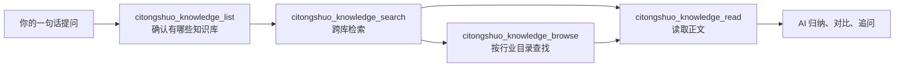

刺桐说社群的研报、纪要与会议资料，可以被你的 AI 助手直接搜索与阅读了——**「刺桐说知识库」正式上线**。

我们把社群多年沉淀的资料整理成了**三个知识库**，做成了一个能被 AI 助手直接调用的知识服务。接入它，你的 AI 助手就相当于多了一位熟悉刺桐说全部资料的"资料员"：找资料、读原文、做对比，一句话就能使唤。

不论你用的是 Claude Desktop、Cursor、Trae，还是其他任何支持 MCP 协议的 AI 客户端，都可以用上它。本文一次说清：它是什么、能做什么、怎么接入，以及加入会员能同时得到什么。

## 一、为什么要做「刺桐说知识库」

### 资料一直都在，只是"调不动"

刺桐说社群的投研资源品类很全：行业深度研报、嘉宾分享纪要、专题会议资料、成员交易复盘……但过去它们更像一座"仓库"：

- 研报按行业散在几十个分类里，想找某个行业的资料，得先翻聊天记录、再翻文件夹；
- 嘉宾分享和专题会议的内容散落在不同时间，很难按主题串起来；
- 找到之后还要自己复制、粘贴到 AI 里，才能请它帮忙分析；
- 换个工具、换台电脑，一切又要重来。

### 让 AI 直接"走进"资料库

MCP 服务解决的，就是把"人找资料 → 喂给 AI"这一步彻底省掉。接入之后，你的 AI 助手可以**主动检索、浏览、读取**刺桐说知识库里的内容，再用它擅长的方式帮你归纳、对比与追问。

### 四个让我们觉得"必须做"的理由

1. **省时间**：从"翻半天"到"问一句"。
2. **找得准**：研报按行业归档、纪要按主题沉淀，还能一次跨三个知识库检索。
3. **不挑工具**：任何支持 MCP 协议的 AI 客户端，填一段配置即可接入。
4. **只读、安全**：全部工具都是只读查询，会员凭证仅用于验证身份，不涉及任何上传、修改或删除。

## 二、它到底能做什么：三个知识库 + 4 个只读工具

### 三个知识库，各管一类资料

| 知识库 | 收录内容 | 组织方式 |
| --- | --- | --- |
| 研究报告 | 行业深度研报 | 按 31 个行业分类整理 |
| 内部纪要 | 嘉宾分享、内部交流纪要 | 按时间顺序整理 |
| 专题会议 | 专题会议资料 | 按专题整理 |

知识库会持续收录最新的研报、纪要与会议资料，新增内容可直接检索。

### 4 个只读工具

「刺桐说知识库」为你的 AI 助手准备了 4 个工具，覆盖"找库 → 找条目 → 读正文"的完整链路：

| 工具 | 它能做什么 | 你可以这样问 |
| --- | --- | --- |
| `citongshuo_knowledge_list` | 列出 / 搜索当前可访问的知识库 | "看看知识库里都有什么？" |
| `citongshuo_knowledge_browse` | 浏览知识库目录，逐层看到文件夹与文件 | "研究报告里都有哪些行业分类？" |
| `citongshuo_knowledge_search` | 按关键词检索，返回相关文档、来源知识库与正文片段；可一次检索全部知识库 | "搜一下新能源汽车的资料" |
| `citongshuo_knowledge_read` | 读取条目正文（无正文时给出提示） | "玻璃基板那篇研报讲了什么？" |

### 一条调用链，AI 自己会跑完

你只需要用大白话提问，剩下的"定位知识库 → 检索条目 → 读取正文"由 AI 自动串联：



### AI 会拿到什么

AI 拿到的是结构化的文本内容，会先归纳再呈现给你。下面是两个简化示例：

跨库搜索时：

```text
在 3 个知识库中搜索「重卡」（命中 2 份文档）：
1. 《2026-07-10重卡全球化专题：非洲重卡市场扩张……》（来源：研究报告）
   片段：非洲重卡市场正处于排放标准切换与车队更新叠加的窗口期……
2. 《2026-06-12 重卡产业链调研纪要》（来源：内部纪要）
   片段：渠道反馈显示，出口订单排产已延至四季度……
```

读取条目正文时：

```text
《2026-07-10重卡全球化专题：非洲重卡市场扩张……》
正文：
……（原文内容）

（内容较长，已截取前 2 万字并给出提示）
```

搜索会直接命中资料正文，返回的不只是标题，还有命中的内容片段，AI 可以据此判断哪几篇值得细读；读取工具则把正文交给 AI，让它直接读、直接总结。

### 全部只读，用起来没有负担

四个工具都是**只读查询**：不会上传文件、不会修改或删除任何内容，也不需要为每一次调用做二次确认。你可以放心把它当作一个"只进不出"的资料入口。

## 三、真实使用示例：它到底好用在哪

下面这些场景，都是接入之后，你可以直接对 AI 说的话。

### 场景一：一句话摸清资料家底

> **你**：刺桐说知识库里都有哪些内容？
>
> **AI**：（调用 `citongshuo_knowledge_list`）目前可访问三个知识库：研究报告（31 个行业分类）、内部纪要、专题会议……

过去要先知道"有什么"，才能开始找；现在只需要问一句，家底一目了然。

### 场景二：跨库找齐一个主题的资料

> **你**：帮我把知识库里新能源汽车相关的研报、纪要和专题会议资料都找出来，整理成一份要点清单。
>
> **AI**：（跨库检索"新能源汽车" → 命中研究报告、内部纪要等多个来源 → 逐篇读取 → 按"行业空间 / 竞争格局 / 风险点"输出清单，并标注每条观点来自研报还是纪要）

这正是「刺桐说知识库」最有价值的地方：**把"检索"和"阅读"合并成一次对话**。你不用先判断资料在哪个库、哪个文件夹，AI 会自己找齐、读完，最后交给你结论。

### 场景三：让 AI 读完长研报，直接给结论

> **你**：玻璃基板那篇研报讲了什么？帮我提炼核心逻辑和关键数据。
>
> **AI**：（检索到条目 → 调用 `citongshuo_knowledge_read` 读取正文 → 提炼核心逻辑、关键数据与风险提示）

对于 PDF 这类长文档，服务会返回正文，AI 可以当场读完并给出摘要，而不是丢给你一个待读的链接。遇到特别长的资料，服务会截取并提示，你可以让 AI 按章节继续追问。

### 场景四：跨资料对比，做"交叉验证"

> **你**：对比一下知识库里关于"AI 算力"和"新能源"的资料，说说各自的核心逻辑是什么？
>
> **AI**：（分别检索两类条目 → 读取正文 → 并排对比行业驱动、关键变量与风险点）

社群最大的价值，是不同视角的**交叉验证**。研报给的是行业框架，纪要给的是从业者的真实反馈；现在，你可以让 AI 把两边的逻辑摆在一起，再由你来做判断。

## 四、如何接入：一次配置

「刺桐说知识库」是一个标准的 **MCP（Model Context Protocol）Streamable HTTP 服务**。只要你的 AI 客户端支持 MCP，就可以接入。

### 连接信息

- **服务地址**：`https://knowledge.citongshuo.online/mcp`
- **认证方式**：`Bearer <你的会员密钥>`
- **协议**：MCP Streamable HTTP

### Claude Desktop / Cursor / Trae 配置示例

在客户端的 MCP 配置中加入下面这段即可：

```json
{
  "mcpServers": {
    "citongshuo-knowledge": {
      "url": "https://knowledge.citongshuo.online/mcp",
      "headers": { "Authorization": "Bearer <你的会员密钥>" }
    }
  }
}
```

保存并重启客户端，你的 AI 助手就会多出 4 个 `citongshuo_knowledge_*` 工具，接下来直接用大白话提问就行。

**两点说明**：

- 服务端会实时校验会员身份：**未开通或已到期的会员无法连接**；
- 会员密钥即你的刺桐说会员编号，关注"刺桐说"微信公众号、订阅社群会员即可获取。

### 连通性自检（可选）

配置完成后，可用一条命令确认服务是否打通（将 `<你的会员密钥>` 替换为实际密钥）：

```bash
curl -X POST https://knowledge.citongshuo.online/mcp \
  -H "Authorization: Bearer <你的会员密钥>" \
  -H "Content-Type: application/json" \
  -H "Accept: application/json, text/event-stream" \
  -d '{"jsonrpc":"2.0","id":1,"method":"tools/list"}'
```

返回 4 个 `citongshuo_knowledge_*` 工具名，即表示连接正常。

> 你的会员密钥仅保存在本机的客户端配置中，不会上传云端，仅用于验证会员身份；不同客户端的配置文件位置不同，请以各自官方说明为准。请勿把会员密钥分享给他人，也不要把含密钥的配置提交到公开仓库。
{: .ct-callout .ct-callout-tip }

## 五、几点说明

### 内容仅限会员本人查阅

刺桐说知识库内的资料为社群内部投研资源，仅限会员本人查阅使用。请尊重原创与版权，不要外传、转发或用于商业用途。

### 关于检索范围

- 检索直接覆盖资料正文，结果按文档去重，并标注来源知识库；
- 一次检索会返回最相关的若干篇；想找得更全，可以缩小关键词或指定某一个知识库；
- 个别资料可能暂时无法读取正文，稍后重试即可。

### 关于正文与边界

- `citongshuo_knowledge_read` 返回正文内容；特别长的资料会截取前 2 万字并给出提示；
- 部分资料暂不提供正文，服务会给出提示并引导你在知识库客户端中查看；
- 知识库以文字资料为主，暂不包含音视频内容。

> 以上为当前版本的已知边界，我们会根据大家的反馈持续迭代。使用中遇到问题，欢迎在社群里提出。
{: .ct-callout .ct-callout-warn }

## 六、加入刺桐说，把你的资料库接上 AI

工具的意义，是让有价值的东西**被用起来**。

「刺桐说知识库」把社群多年积累的研报、纪要与会议资料，变成你 AI 助手里随时可调用的一座"图书馆"。它不是又一个聊天机器人，而是帮你把**资料、经验与 AI 的判断力**连成一条线。

**会员权益不止于此**：配合已上线的「刺桐说金融AI数据库」MCP 服务，你的 AI 助手还能直接查询 A 股、港股、美股的行情、财务、资金流等 35 类金融数据。一个接数据、一个接资料，合起来才是一套完整的 AI 投研装备；两个服务，同一份会员密钥即可使用。

如果你希望——

- 找资料不用再翻聊天记录；
- 让 AI 帮你读完研报、给出要点与对比；
- 和一群来自券商、基金、期货、银行的专业投资者同频交流；

那么，欢迎加入刺桐说：**访问[加入社群](/about/)页面，扫描二维码加入我们。**

订阅会员后即可获取会员密钥，在任意支持 MCP 的客户端中完成配置即可使用。期待在社群里，看到你的精彩输出与贡献。

**配套阅读**：[《「刺桐说金融AI数据库」正式上线》](/2026/08/21/citongshuo-data-mcp-launch/)

免责声明：本文仅为市场分析，基于公开信息整理，不构成任何投资建议。作者未持有证券投资咨询资格，相关内容仅供参考。投资有风险，入市需谨慎！